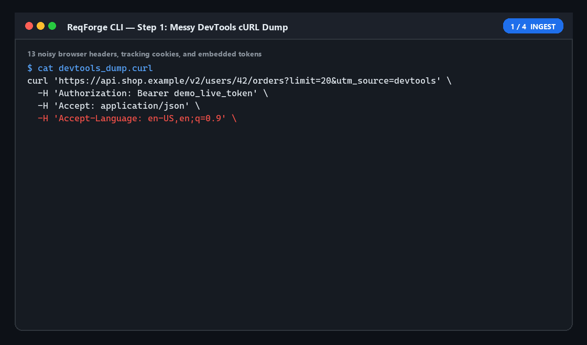
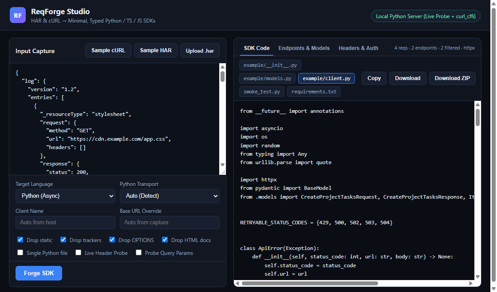
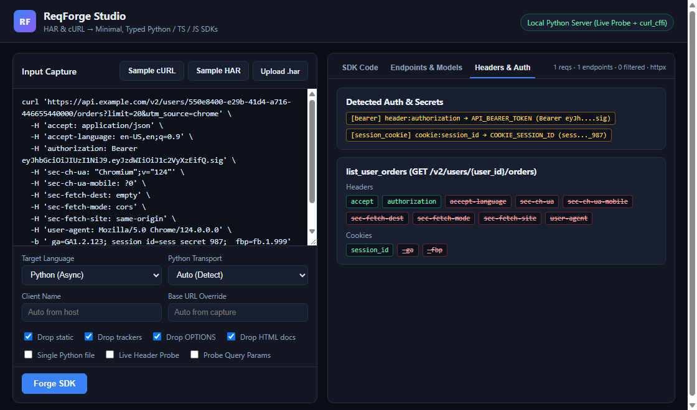

<div align="center">


<p>
  
  
  
  
  
</p>

<br />



</div>

---

## Why ReqForge?

Whenever you inspect a site or API in Chrome DevTools (**Copy as cURL** or **Save all as HAR**) to build a lightweight request-based tool, you inherit 25 noisy browser headers, tracking cookies (`_ga`, `_fbp`), hardcoded tokens, and fragile boilerplate.

**ReqForge** strips the noise, optionally replays and probes live endpoints with `httpx` or `curl_cffi` to isolate the **exact minimal headers, cookies, and query params** required for a valid response, infers dynamic routes & JSON models, and emits a clean, ready-to-run async SDK + smoke test — **100% locally with zero LLMs and zero paid APIs.**

<table>
  <tr>
    <td width="50%">
      <h3>🧹 Noise &amp; Tracker Filtering</h3>
      <ul>
        <li>Drops static files (<code>.css</code>, <code>.js</code>, fonts, images, media), preflight <code>OPTIONS</code>, HTML documents, and telemetry beacons</li>
        <li>Strips browser bloat (<code>sec-ch-ua*</code>, <code>sec-fetch-*</code>, <code>priority</code>, <code>dnt</code>) &amp; tracking cookies (<code>_ga</code>, <code>_fbp</code>, <code>_hj*</code>)</li>
      </ul>
    </td>
    <td width="50%">
      <h3>🔬 Live Delta-Debugging Probe</h3>
      <ul>
        <li>Binary-splits headers, cookies, and query params against the live endpoint in logarithmic HTTP calls</li>
        <li>Detects soft-200 error payloads &amp; HTML redirects, and auto-detects when <code>curl_cffi</code> TLS impersonation is required</li>
      </ul>
    </td>
  </tr>
  <tr>
    <td width="50%">
      <h3>🧬 Parameter &amp; Schema Inference</h3>
      <ul>
        <li>Clusters paths into parameterized routes (<code>/users/{user_id}/orders</code>), splits GraphQL by <code>operationName</code> &amp; JSON-RPC by <code>method</code></li>
        <li>Merges multi-sample JSON payloads into Pydantic v2 models and TypeScript interfaces with nullable/optional tracking</li>
      </ul>
    </td>
    <td width="50%">
      <h3>⚡ Multi-Target SDK + Web Studio</h3>
      <ul>
        <li>Generates pooled async Python (<code>httpx</code> / <code>curl_cffi</code>), typed TypeScript, and ESM JavaScript <code>fetch</code> clients with retries &amp; <code>from_env()</code></li>
        <li>Includes <code>reqforge ui</code> local studio + <code>reqforge export-web</code> standalone Pyodide browser bundle</li>
      </ul>
    </td>
  </tr>
</table>

---

## Before vs. After

<table>
  <tr>
    <th>Chrome DevTools Copy as cURL (Before)</th>
    <th>Generated Async Python Client (After)</th>
  </tr>
  <tr>
    <td width="50%">

```bash
curl 'https://api.shop.example/v2/users/42/orders?limit=20&utm_source=devtools' \
  -H 'Authorization: Bearer eyJhbGci...' \
  -H 'Accept-Language: en-US,en;q=0.9' \
  -H 'sec-ch-ua: "Chromium";v="124"' \
  -H 'sec-ch-ua-mobile: ?0' \
  -H 'sec-fetch-dest: empty' \
  -H 'sec-fetch-mode: cors' \
  -H 'sec-fetch-site: same-origin' \
  -H 'User-Agent: Mozilla/5.0 ...' \
  -H 'Priority: u=1, i' \
  -b '_ga=GA1.2.9; _fbp=fb.1; sid=sess_99'
```

</td>
    <td width="50%">

```python
async with OrdersClient.from_env() as client:
    orders = await client.list_user_orders(
        user_id=42,
        limit=20,
    )
    print(orders.next_cursor, len(orders.orders))
```

</td>
  </tr>
</table>

---

## ReqForge vs. Existing Tools

| Capability | Raw DevTools / Scripts | `curlconverter` | `har-to-openapi` | **ReqForge** |
| :--- | :---: | :---: | :---: | :---: |
| Multi-cURL (Bash, CMD, PowerShell) + HAR 1.2 | ❌ | ⚠️ 1-to-1 | ❌ HAR only | ✅ |
| Static asset & tracker request filtering | ❌ | ❌ | ⚠️ Partial | ✅ |
| Live `ddmin` header, cookie & query probing | ❌ | ❌ | ❌ | ✅ |
| Browser TLS detection (`httpx` vs `curl_cffi`) | ❌ | ❌ | ❌ | ✅ |
| Auth detection + secret extraction to env vars | ❌ | ❌ | ❌ | ✅ |
| Multi-request route clustering & schema merging | ❌ | ❌ | ⚠️ OpenAPI only | ✅ |
| Async Python (`httpx`/`curl_cffi`) + TS + JS SDKs + Smoke Test | ❌ | ❌ Snippets only | ❌ Needs 2nd tool | ✅ |
| Local Web Studio + Zero-Backend Browser Mode | ❌ | ⚠️ Web snippets | ❌ | ✅ |

---

## Installation

```bash
git clone https://github.com/tejzv/reqforge.git
cd reqforge
pip install -e ".[all]"
```

Core parsing, filtering, schema inference, SDK generation, and the stdlib Web Studio run with **zero required dependencies** (`pip install -e .`). Installing `.[all]` enables live HTTP probing with `httpx`, TLS browser impersonation via `curl_cffi`, and Pydantic model validation.

---

## Quick Start

### Analyze a HAR Capture or cURL Dump

```bash
reqforge analyze capture.har
reqforge analyze capture.har --json
```

### Live Header, Cookie & Query Minimization Probe

```bash
reqforge probe request.curl
reqforge probe request.curl --probe-query --probe-transport auto
reqforge probe request.curl --out cleaned_report.json
```

### Generate Clean Typed SDKs + Smoke Tests

```bash
reqforge generate request.curl --target python --probe --out ./sdk
reqforge generate request.curl --target python --transport curl_cffi --single-file --out ./sdk
reqforge generate capture.har --target typescript --out ./ts_sdk
reqforge generate capture.har --target javascript --out ./js_sdk
reqforge generate capture.har --target all --out ./generated_sdks
```

Pipe directly from clipboard / stdin:

```bash
cat devtools.curl | reqforge generate - --stdout --single-file --target python
```

### Launch ReqForge Studio (Local Web UI)

```bash
reqforge ui
```

Opens the interactive browser workbench with CORS-free live probing, visual header/cookie diff chips, schema field previews, and 1-click **Download ZIP** export.

### Export Static Browser Bundle (`tejv.in` / Static Hosting)

```bash
reqforge export-web --out ./dist_web
```

Packages the exact Python core into `reqforge_core.zip` alongside `index.html`, `styles.css`, and `app.js`, automatically executing in-browser via Pyodide when no local backend server is present.

---

<details>
<summary><b>🛠️ CLI Reference &amp; Studio Previews</b></summary>

<br />

| Command | Purpose | Key Flags |
| :--- | :--- | :--- |
| `reqforge analyze <input>` | Inspect endpoints, auth findings, stripped noise & inferred schemas | `--json`, `--include-host`, `--exclude-host`, `--only-json` |
| `reqforge probe <input>` | Replay requests via `ddmin` to isolate minimum required headers & cookies | `--probe-transport`, `--probe-query`, `--no-probe-cookies`, `--max-probes`, `--out` |
| `reqforge generate <input>` | Emit Python (`httpx`/`curl_cffi`), TypeScript, or JavaScript SDK + smoke test | `--target`, `--transport`, `--probe`, `--single-file`, `--name`, `--base-url`, `--out`, `--stdout` |
| `reqforge ui` (`serve`) | Launch local interactive Web Studio server | `--host`, `--port`, `--no-open` |
| `reqforge export-web` | Build static Pyodide-powered web bundle | `--out` |

<p align="center">
  
  <br /><br />
  
</p>

</details>

---

## Running Tests

```bash
python -m unittest discover -s tests -v
```

---

## Community & Support

- **Discord Server**: https://discord.gg/PYfeSaDGPJ
- **Contact**: [@sqnq](https://discord.com/users/987979957907116052)
- **Website**: [tejv.in](https://tejv.in)

### Buy Me A Coffee ☕

**Litecoin (LTC)** — click copy on the right:

```text
LbDG5BE3foVsfK6JRsSc7UtBVX4DqYYKXN
```

<div align="center">

**Made With ♥️ By [Tej](https://github.com/tejzv)**


</div>
